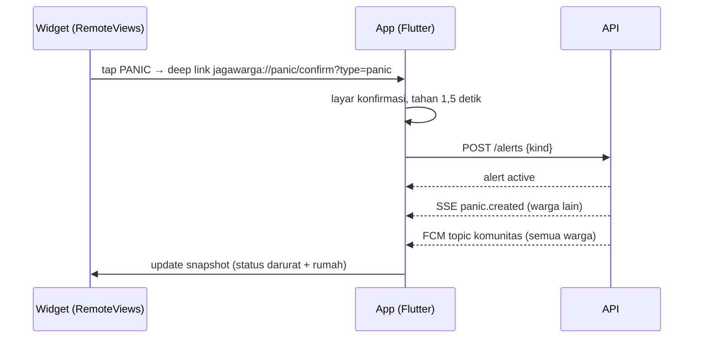

# Widget & notifikasi — desain

Dokumen ini menjawab tiga hal: (1) APK mana yang bisa dipakai warga, (2) widget layar utama untuk minta bantuan, (3) notifikasi push saat panic. Bagian akhir berisi rencana implementasi + kriteria terima. Belum ada kode yang diubah.

---

## 1. APK: apa yang bisa dipakai sekarang

| Artefak | Ukuran | Bisa dipakai? | Catatan |
|---|---|---|---|
| `app-debug.apk` (sekarang) | 240 MB | untuk uji internal di emulator/HP sendiri | debug + semua ABI, lambat, belum ada push (tanpa Firebase) |
| `flutter build apk --release --split-per-abi` | ±12–18 MB per ABI | **ya, untuk dibagikan** | ditandatangani debug key (bawaan template) → layak untuk uji warga, **tidak** untuk Play Store |
| `flutter build appbundle --release` | ±20 MB | untuk Play Store | butuh upload keystore + `versionCode` naik tiap rilis |

Syarat agar APK benar-benar berguna di HP warga:

1. **Alamat API produksi**, bukan LAN:
   `flutter build apk --release --split-per-abi --dart-define=API_BASE_URL=https://jagawarga.domain.id`
   Build release memblokir HTTP biasa — API harus HTTPS (sudah disiapkan Caddy).
2. **Push**: butuh project Firebase + `google-services.json` (Android) dan `FCM_SERVICE_ACCOUNT_JSON` (server). Tanpa itu app tetap jalan, tetapi panic hanya realtime saat app terbuka.
3. **Signing**: ganti `signingConfigs.debug` dengan keystore rilis sebelum Play Store; simpan keystore + password di tempat aman.
4. **Versi**: `version: 1.0.0+1` di `pubspec.yaml` (versionCode harus naik setiap unggah).
5. Distribusi: Play Store internal testing (paling aman) atau bagi APK langsung + panduan aktifkan "instal dari sumber tidak dikenal". iOS belum bisa (butuh Xcode + APNs).

---

## 2. Widget layar utama

### 2.1 Inventaris

| Widget | Ukuran | Isi | Tap |
|---|---|---|---|
| **Panic** | 2×2 | status komunitas (Aman / N darurat), tombol merah besar PANIC, "diperbarui 12:03" | tombol → buka layar konfirmasi panic |
| **Bantuan** | 4×2 | tombol panic + 3 tombol cepat: **Maling**, **Kebakaran**, **Medis**; baris bawah: tagihan belum bayar | tombol → konfirmasi dengan jenis terpilih |
| **Info** | 4×1 | pengumuman terakhir + tagihan bulan ini | buka pengumuman / keuangan |

Ketiga widget bisa dipasang bersamaan; tidak ada widget yang mengirim panic tanpa konfirmasi.

### 2.2 Mengapa widget tidak langsung mengirim panic

`AppWidget` (RemoteViews) hanya mendukung *tap*, bukan *press-and-hold*, dan tidak punya akses ke `flutter_secure_storage`. Mengirim langsung dari widget berarti:

- risiko **panic palsu** karena tap tidak sengaja di kantong,
- token harus disimpan di SharedPreferences biasa agar bisa dipakai background worker → menurunkan keamanan,
- logika rate-limit/pembatalan 10 detik terduplikasi di dua tempat.

**Keputusan**: tap widget membuka **layar konfirmasi penuh** (route `/panic/confirm`) yang memakai jalur panic yang sudah diuji — tahan 1,5 detik, GPS best-effort, fallback telepon pengurus. Waktu buka app ±1 detik di HP kelas menengah; masih jauh lebih cepat daripada membuka app lalu mencari tombol.

Alternatif yang ditolak untuk MVP: *two-tap* di widget (tap → layout berubah "KONFIRMASI" → tap kedua mengirim) karena tetap rawan salah tekan dan memerlukan penyimpanan token di background.

### 2.3 Alur



### 2.4 Status widget

| Snapshot | Tampilan |
|---|---|
| `safe` | latar terang, pil hijau "Aman", waktu update |
| `alert` | latar merah muda, "DARURAT — Blok A No. 3", tombol PANIC tetap aktif |
| `offline` | data terakhir + "Terakhir diperbarui 12:03", tombol tetap membuka app |
| `unauthenticated` | "Masuk untuk mengaktifkan" (tap → `/login`) |
| `disabled` | (widget belum dipasang) |

Aturan: widget **tidak pernah** menampilkan data komunitas lain; snapshot membawa `communityId` dan widget di-reset saat logout/switch komunitas.

### 2.5 Data & penyegaran

- Snapshot JSON kecil (±300 byte) ditulis Flutter ke `SharedPreferences` lewat `home_widget`, widget membaca saat `onUpdate`.
- Pemicu update: app dibuka, alert dibuat/diubah (SSE), pengumuman terbit, logout/login, widget dipasang.
- Periodik: `WorkManager` tiap 30 menit untuk memperbarui status & tagihan (minimum Android 15 menit; 30 menit hemat baterai).
- Saat tidak ada jaringan: pertahankan snapshot lama + tandai waktu update.

### 2.6 Anatomi & ukuran

- Padding 12dp, radius 20dp, kontras teks ≥4.5:1.
- Tombol PANIC: lingkaran 88dp di widget 2×2, 64dp di 4×2; target sentuh ≥48dp.
- Ikon + label teks (tidak pernah warna saja).
- Mendukung dark mode (mengikuti tema sistem) dan lebar minimum 2 sel (110dp).

---

## 3. Jenis bantuan

Server saat ini punya `kind: panic | medical | fire`. Tambahan yang diusulkan:

| Tombol | `kind` | Judul push | Nada |
|---|---|---|---|
| PANIC | `panic` | 🚨 PANIC: Blok A No. 3 | paling keras, channel `panic` |
| Maling | `security` (**baru**) | 🚨 MALING: Blok A No. 3 | channel `panic` |
| Kebakaran | `fire` | 🔥 KEBAKARAN: Blok A No. 3 | channel `panic` |
| Medis | `medical` | 🚑 MEDIS: Blok A No. 3 | channel `panic` |
| Butuh bantuan lain | – | – | buka WhatsApp pengurus (tanpa alert) |

"Bantuan lain" sengaja tidak membuat alert: permintaan non-darurat (pinjam alat, angkat barang) tidak boleh membangunkan satu kampung. Cukup `wa.me` ke pengurus dari daftar `GET /community/staff`.

Dampak teknis: satu nilai enum di `contracts.ts` + `CHECK` di tabel `alerts`, ikon/label di klien, dan test. Pipeline panic tidak berubah.

---

## 4. Notifikasi push

### 4.1 Yang sudah ada di kode

- Panic → tulis inbox `notifications` untuk semua anggota aktif **dan** kirim FCM ke topic `community_<id>`.
- Payload: `data {type:'panic', alertId, status}`, `android.priority=high`, `channelId=panic`, `apns-priority=10`, `interruption-level=time-sensitive`.
- Acknowledge/resolve → push singkat `alert_update`; pengumuman → `announcement`.
- Tanpa kredensial FCM: adapter log saja (dev).

### 4.2 Yang ditambahkan

| Perubahan | Alasan |
|---|---|
| Channel Android `panic` (importance max, suara default, getar) + `default` (pengumuman) | memisahkan notifikasi darurat agar bisa diatur pengguna |
| `android.notification.tag = alertId` | update status **menggantikan** notifikasi lama, bukan menumpuk |
| Topic kedua `community_<id>_responders` untuk `pengurus`/`satpam` | petugas dapat notifikasi tambahan dengan teks "Anda petugas — segera respons" |
| Aksi notifikasi **"Saya merespons"** | membuka app langsung ke alert dengan aksi ter-queue (bukan memanggil API dari background) |
| Log hasil kirim per alert di `alert_events.meta` | bisa diaudit kalau warga mengaku tidak menerima |
| `alert.kind` → judul/ikon berbeda | warga langsung tahu jenis bahaya |

### 4.3 Contoh notifikasi

```
🚨 PANIC: Blok A No. 3
Budi Santoso mengirim sinyal darurat · 2 menit lalu
[ Saya merespons ]  [ Lihat ]
```

- Judul ≤40 karakter, badan ≤120, tanpa data sensitif (tidak ada koordinat).
- Tap → `/panic/<id>`.
- Notifikasi pengumuman memakai channel `default` dan tidak berbunyi di luar jam tenang (mengikuti setelan pengguna).

### 4.4 Batasan platform

- Android 13+ butuh izin `POST_NOTIFICATIONS` (sudah diminta saat login).
- iOS: `time-sensitive` butuh capability; *critical alert* (menembus silent mode) butuh entitlement khusus dari Apple — jangan dijanjikan.
- Do Not Disturb: channel `panic` memakai importance max; menembus DND sepenuhnya hanya mungkin untuk aplikasi alarm (kebijakan Play). Jangan mengklaim bisa menembus DND.
- Penghemat baterai OEM (Xiaomi/Oppo) bisa menunda push; sediakan panduan singkat "izinkan autostart" di halaman bantuan.

---

## Status implementasi

| Fase | Status |
|---|---|
| A — APK rilis internal | belum (butuh keystore) |
| B — Notifikasi | **sebagian**: judul per jenis, `tag=alertId`, topic responders, log `notified` sudah ada. Tombol aksi di notifikasi belum (butuh pesan data-only + local notification). |
| C — Widget | **dasar selesai**: 3 provider native + snapshot + tap ke layar konfirmasi. Belum: refresh periodik & pemasangan otomatis |
| D — Jenis bantuan | **selesai**: `kind=security` + layar konfirmasi 4 jenis + tombol bantuan cepat di beranda |

## 5. Rencana implementasi

### Fase A — APK rilis internal (½ hari)

1. Tambah `signingConfigs.release` (keystore baru) + `flutter build appbundle`.
2. `API_BASE_URL` produksi; uji instal di 2 HP fisik.
3. Terima: login, panic (app terbuka), lapor bayar, terima notifikasi inbox.

### Fase B — Notifikasi (1–2 hari)

1. Buat project Firebase, daftar app Android `id.my.temancode.jagawarga`, simpan `google-services.json` (di-`.gitignore`).
2. Server: isi `FCM_SERVICE_ACCOUNT_JSON`; tambahkan `tag`, topic responders, log hasil kirim.
3. App: channel `default` + `panic` (dibuat saat init), aksi "Saya merespons" → deep link, panduan izin.
4. Terima: HP A di background → panic dari HP B → notifikasi muncul <5 detik, tap membuka alert, ack dari notifikasi berfungsi.

### Fase C — Widget (2–3 hari)

1. `flutter pub add home_widget`; `AppWidgetProvider` + 3 layout XML (2×2, 4×2, 4×1), `appwidget-provider` metadata, preview.
2. Deep link: intent-filter `jagawarga://` di `MainActivity`; go_router menangani `/panic/confirm?type=…`.
3. `WidgetService`: tulis snapshot, `updateWidget` pada login/logout/panic/announcement/SSE, WorkManager 30 menit.
4. Terima: pasang widget → status "Aman"; panic dari HP lain → widget berubah "DARURAT" tanpa membuka app; tap PANIC → layar konfirmasi; logout → widget "Masuk untuk mengaktifkan".

### Fase D — Jenis bantuan (½ hari)

1. Tambah `security` ke `kind` (contracts + CHECK + migrasi).
2. Bottom sheet "Bantuan cepat" dengan 4 jenis + WhatsApp pengurus.
3. Terima: tiap jenis menghasilkan judul push berbeda; `security` tercatat di riwayat alert.

### Risiko yang perlu diputuskan saat implementasi

| Risiko | Mitigasi |
|---|---|
| Widget update di OEM tertentu tertunda | sediakan tombol refresh di app + panduan; jangan menjanjikan realtime di widget |
| Notifikasi "Saya merespons" membuka app (bukan aksi senyap) | diterima untuk MVP; aksi senyap perlu WorkManager + token di background |
| DND tidak bisa ditembus | dokumentasikan di onboarding warga |
| Play Store menolak kata "PANIC" di metadata? | gunakan "Darurat" di listing; nama internal tidak masalah |
