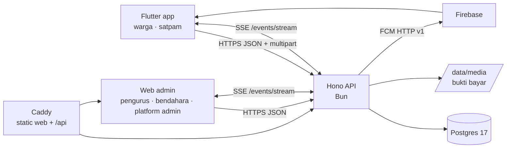

# Arsitektur

## Ringkasan

Monorepo, satu deployment per instance, tiga klien:



| Paket | Teknologi | Tanggung jawab |
|---|---|---|
| `server/` | Bun 1.4, Hono, Zod 4, Drizzle ORM, postgres.js | API JSON, SSE, FCM, penyimpanan media |
| `app/` | Flutter 3.50, Riverpod 3, go_router, Dio | klien warga & satpam (Android-first) |
| `web/` | React 19, Vite 7, TanStack Query 5, Tailwind 4 | admin pengurus/bendahara/platform |

Tidak ada SSR. Web hanya SPA statis; Caddy menyajikan `dist/` dan mem-proxy `/api/*` (SSE tanpa buffering).

## Siklus request

1. Klien mengirim `Authorization: Bearer <access>`.
2. `withAuth` memverifikasi JWT HS256 (15 menit) → `c.set('auth', …)`.
3. Untuk route komunitas, `withCommunity` memuat membership dari DB (bukan hanya klaim token) lalu menolak bila membership atau komunitas nonaktif. Ini membuat penonaktifan anggota/suspend komunitas berlaku seketika walau token belum kedaluwarsa.
4. Handler memanggil `ensure(auth, 'capability')` — satu-satunya sumber izin ([permissions.md](permissions.md)).
5. Query selalu menyertakan `community_id` dari `auth`, sehingga isolasi tenant tidak bergantung pada parameter klien.
6. Error dilempar sebagai `ApiError` → `application/problem+json`.

## Multi-tenancy (satu deployment, banyak kampung)

- Setiap tabel milik komunitas membawa `community_id`; unique constraint selalu menyertakannya (mis. tagihan unik per `community_id + house_id + period`).
- Semua akses data memakai `auth.communityId`; `houseId` di klaim hanya untuk scoping rumah (warga).
- Role disimpan per komunitas di `memberships` — satu akun bisa menjadi warga di kampung A dan bendahara di kampung B.
- Platform admin **tidak** otomatis bisa membaca data komunitas: ia hanya memakai `/admin/*`; untuk masuk ke data komunitas harus `join` (membuat membership `admin`, tercatat di `audit_logs`) lalu `switch-community`.
- RLS Postgres sengaja belum dipakai karena hanya API yang memegang kredensial DB ([security.md](security.md)).

## Realtime (SSE)

- Satu endpoint: `GET /api/v1/events/stream`.
- Registry in-memory per komunitas; heartbeat `ping` tiap 25 detik; ring buffer 100 event terakhir untuk replay via `Last-Event-ID` (klien mengirim header saat reconnect).
- Event: `panic.created`, `panic.updated`, `announcement.published`, `stream.ready`.
- Setelah reconnect, klien memuat ulang `GET /alerts/active` sebagai sumber kebenaran; SSE hanya jalur cepat, bukan penyimpanan.
- Konsekuensi: satu instance API. Scale-out memerlukan Redis pub/sub ([roadmap.md](roadmap.md)).

## Push notification

- FCM topic per komunitas: `community_<communityId>`; klien subscribe setelah login.
- Setiap panic/announcement menulis baris `notifications` (inbox) untuk **semua** anggota aktif **dan** mengirim push. Inbox adalah sumber kebenaran; push best-effort (kegagalan push tidak menggagalkan request).
- Panic memakai `priority: high`, channel Android `panic` (importance max), `apns-priority 10`, `interruption-level: time-sensitive`.
- Judul mengikuti jenis bantuan (`PANIC`/`MALING`/`KEBAKARAN`/`MEDIS`); `tag=alertId` membuat update status menggantikan notifikasi sebelumnya. Pengurus/satpam juga berlangganan topic `community_<id>_responders` dan menerima notifikasi tambahan.
- Setiap upaya kirim dicatat sebagai event timeline `notified` (`meta.community`, `meta.responders`), sehingga klaim "tidak menerima notifikasi" bisa diaudit.
- Tanpa `FCM_SERVICE_ACCOUNT_JSON`: di `APP_ENV=development` adapter menjadi log saja; di production server menolak boot.

## Panic: state machine

```
             cancel (<=10 s, pemicu)
active ────────────────► cancelled
  │  ▲
  │  └── acknowledge (pengurus/satpam) ──► acknowledged
  │                                            │
  └──────────── resolve (pemicu/petugas) ──────┴──► resolved
```

Aturan yang ditegakkan di `modules/alerts/service.ts`:

- Maksimal satu alert `active` per pemicu (409 `alert_active`) dan jeda 30 detik antar pembuatan (429).
- Minimal satu baris `alert_events` per aksi; timeline tidak bisa dihapus.
- `cancel` hanya oleh pemicu dan maksimal 10 detik sejak dibuat.
- `resolve` boleh oleh pemicu sendiri meski role-nya `warga`.
- Fan-out tunggal di `publishPanic()` — titik sisip sirine/webhook ([roadmap.md](roadmap.md)).

## Uang

- Nominal `bigint` rupiah utuh (tanpa sen), dikirim sebagai JSON number.
- Persetujuan pembayaran berjalan dalam satu transaksi:
  1. `SELECT … FOR UPDATE` pada baris `payments`,
  2. tolak bila status bukan `pending` (409, idempoten),
  3. update status + `reviewed_by/at`,
  4. insert `ledger_entries` dengan `source_payment_id` unik,
  5. hitung ulang status tagihan dari total pembayaran `approved` (`unpaid`/`partial`/`paid`).
- Approve kedua tidak pernah bisa menggandakan ledger: kunci baris + unique constraint.
- Ringkasan kas (`GET /finance/summary`) menghitung saldo awal dari semua entri sebelum `from`, lalu masuk/keluar pada rentang, sehingga saldo akhir konsisten tanpa tabel saldo terpisah.
- Donasi memakai pola identik dengan `source_donation_id` dan kategori `donasi`.

## Media

- Unggah: multipart atau JSON (tanpa berkas), maks 5 MB, hanya JPEG/PNG/WebP (dicek dari magic bytes, bukan `Content-Type` klien).
- Disimpan di `MEDIA_DIR/<communityId>/<uuid>.<ext>`; key tidak pernah berasal dari input klien.
- `MEDIA_DIR` relatif diresolusi terhadap root repo agar `make dev`, `bun test`, dan skrip verifikasi menulis ke folder yang sama.
- Disajikan `GET /media/:id/raw` dengan cek membership komunitas; cache immutable 1 tahun (nama file UUID).
- Tidak ada transcoding/thumbnail di server; kompresi dilakukan klien (1280 px, kualitas 60) sehingga satu bukti ±150–300 KB.

## Struktur kode server

```
src/
  app.ts          # rakit route + CORS + bodyLimit + error handler
  index.ts        # bootstrap Bun.serve (maxRequestBodySize 10 MB), shutdown
  env.ts          # validasi env (Zod), gagal boot bila kurang
  contracts.ts    # schema Zod + tipe response (dipakai web via import type)
  db/             # schema, client, migrate
  lib/            # jwt, password (Bun.password), problem, permissions, sse, push,
                  # notify, storage, http (parse/cursor), ratelimit, ids, invites, dotenv
  middleware/     # withAuth, withCommunity, withPlatformAdmin
  modules/        # auth, admin, community, invites, alerts, announcements,
                  # notifications, media, finance, campaigns
```

Pemetaan middleware → path didaftarkan sekali di `app.ts` (`scopedPaths`) supaya tidak ada modul yang diam-diam lolos autentikasi. Menambah modul baru berarti menambah prefix-nya di sana.

## Keputusan desain yang mengikat

1. **Izin dikunci di kode**, bukan konfigurasi DB. Pengurus mengatur *role anggota*, bukan izin role.
2. **Rumah adalah unit data**, bukan user: tagihan menempel ke `houses`, anggota keluarga berbagi rumah, panic tetap mencatat orang yang menekan.
3. **Kode undangan sekali pakai**, kedaluwarsa, dan terikat role/rumah; kepala keluarga boleh mengundang anggota rumahnya sendiri (maks 6 anggota, 5 kode aktif).
4. **Inbox notifikasi selalu ditulis**, karena aplikasi harus tetap berguna saat push gagal/nonaktif.
5. **Uang tidak pernah memakai float** dan tidak pernah dipercaya dari klien untuk perhitungan status; server menghitung ulang dari baris pembayaran.
