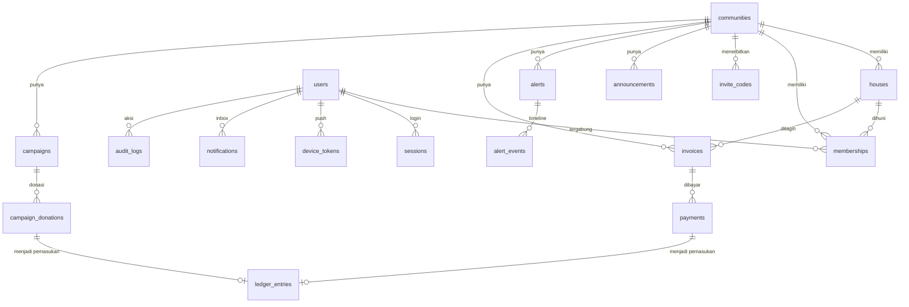

# Database

Postgres 17. Sumber kebenaran skema: `server/src/db/schema.ts`; migrasi SQL di `server/drizzle/`.

## Peta tabel



## Tabel

| Tabel | Isi penting | Constraint kunci |
|---|---|---|
| `communities` | `name`, `slug` unik, `is_active` | suspend memblokir login/refresh |
| `users` | `phone` unik, `password_hash` (argon2id), `interests[]`, `directory_visible`, `is_platform_admin` | satu akun lintas komunitas |
| `houses` | `community_id`, `block`, `number`, `label`, `is_occupied` | unik `(community_id, block, number)` |
| `memberships` | `role`, `house_id`, `is_active`, `is_household_head` | unik `(community_id, user_id)`; **partial unique** satu kepala keluarga per rumah |
| `invite_codes` | `code` unik, `kind` (`staff`/`household`), `role`, `house_id`, `expires_at`, `used_by/at`, `revoked_at` | sekali pakai; kode household 7 hari |
| `sessions` | `token_hash` unik (SHA-256 refresh token), `expires_at`, `revoked_at` | rotasi saat refresh |
| `device_tokens` | `token` unik, `platform` | upsert per token |
| `media` | `community_id`, `owner_id`, `mime`, `bytes`, `storage_key` | berkas di disk, bukan di DB |
| `announcements` | `title`, `body`, `category`, `is_pinned`, `published_at` | draf = `published_at null` |
| `notifications` | `user_id`, `type`, `title`, `body`, `data` jsonb, `read_at` | selalu ditulis saat fan-out |
| `alerts` | `status`, `kind`, `house_id`, `message`, `lat/lng`, ack/resolve/cancel | status: `active/acknowledged/cancelled/resolved` |
| `alert_events` | `alert_id`, `actor_id`, `type` (`created/notified/acknowledged/resolved/cancelled`), `meta` | append-only timeline; `notified` menyimpan hasil push |
| `invoices` | `house_id`, `period` (`YYYY-MM`), `amount`, `due_date`, `status` | unik `(community_id, house_id, period)` |
| `payments` | `invoice_id`, `amount`, `proof_media_id`, `status`, `reviewed_by/at` | `pending/approved/rejected` |
| `ledger_entries` | `direction`, `category`, `amount`, `occurred_on`, `source_payment_id`, `source_donation_id` | kedua `source_*` unik → anti-dobel |
| `campaigns` | `title`, `target_amount`, `deadline`, `status` | `open/closed` |
| `campaign_donations` | `campaign_id`, `donor_name`, `is_anonymous`, `amount`, `proof_media_id`, `status` | pola review sama dengan pembayaran |
| `audit_logs` | `actor_id`, `community_id`, `action`, `target_type/id`, `meta` | aksi platform admin |

Semua `id` UUID (`gen_random_uuid()`), semua waktu `timestamptz`.

## Indeks

- `alerts(community_id, status)` dan `alerts(community_id, created_at desc)` — layar alert & riwayat.
- `notifications(user_id, read_at)` — badge unread.
- `announcements(community_id, published_at desc)` — feed.
- `ledger_entries(community_id, occurred_on)` — laporan kas.
- `media(owner_id, created_at)` — batas unggahan harian.
- GIN `users(interests)` — filter direktori.
- `memberships(community_id)`; partial unique kepala keluarga (lihat tabel).
- `audit_logs(actor_id, created_at)`.

## Invariant

1. **Uang**: `amount > 0`; rupiah utuh; status tagihan adalah turunan dari total pembayaran `approved` — tidak ada kolom saldo yang di-update manual.
2. **Ledger unik per sumber**: satu pembayaran/donasi hanya boleh menghasilkan satu baris kas (`source_payment_id` / `source_donation_id` unik). Approve kedua ditolak sebelum insert.
3. **Satu kepala keluarga per rumah** (partial unique) dan maksimum 6 anggota aktif per rumah (ditegakkan di `auth/activate`).
4. **Invite sekali pakai**: klaim dilakukan dengan `UPDATE … WHERE used_by IS NULL RETURNING`, sehingga dua aktivasi bersamaan tidak bisa memakai kode yang sama.
5. **Alert unik aktif per pemicu**: dicek aplikasi (bukan constraint) karena status berubah-ubah; dijaga oleh `createAlert`.
6. **Isolasi tenant**: setiap query menyertakan `community_id`; tidak ada endpoint yang menerima `communityId` dari klien untuk data komunitas.

## Migrasi

```bash
cd server
bun run db:generate     # schema.ts → drizzle/xxxx.sql
bun run db:migrate      # jalankan migrasi
```

Catatan operasional: drizzle menyimpan jurnal di schema `drizzle`. Reset total (dev):

```bash
make reset    # drop schema public + drizzle, migrate, seed
```

## Seed & DB test

- `server/src/seed.ts` — idempoten: berhenti dengan `seed skipped` bila `communities` sudah berisi.
  Isi: 1 komunitas `Kampung Jaga Demo` (slug `demo`), 12 rumah (5 berpenghuni), 8 akun (password `Rahasia123!`), 3 kode undangan `DEMO-WARGA-1..3`, 1 pengumuman terbit, 1 kampanye donasi, 5 tagihan bulan berjalan.
- `jagawarga_test` dibuat otomatis oleh `deploy/initdb/01-test-db.sql`. `server/test/setup.ts` (preload Bun) menjalankan drop schema + migrasi sekali per `bun test`.

## Retensi

Tidak ada penghapusan otomatis. Saran saat data bertumbuh:

- `notifications` dan `alert_events` boleh diarsip setelah 12 bulan.
- `audit_logs` disimpan permanen (jejak platform admin).
- Media finansial (bukti bayar) jangan dihapus selama periode audit komunitas; lihat [operations.md](operations.md) untuk ukuran penyimpanan.
